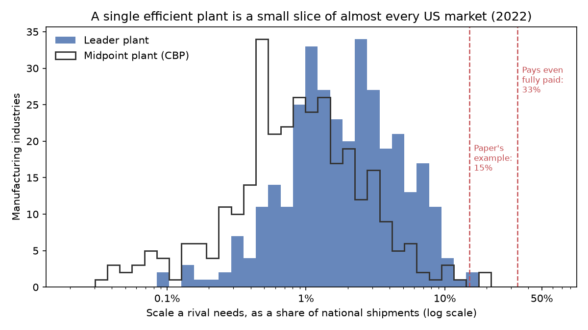
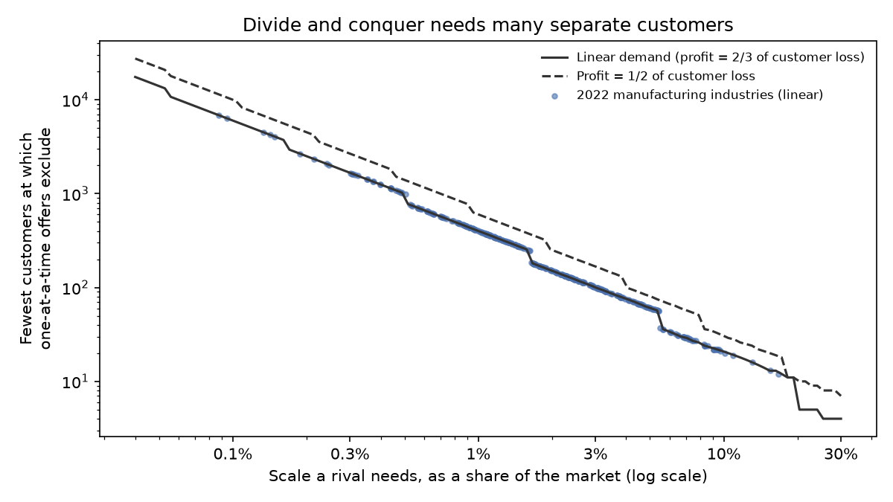

# Locking Up the Customers

### In 1991, Eric Rasmusen, Mark Ramseyer and John Wiley showed how a dominant company could shut out a rival by paying its customers almost nothing. I asked how much of an American market that would take today.

---

A set of dentures is built in a dental laboratory, but the teeth in it are usually bought ready-made. For at
least a decade before the government's case against it reached trial, three of every four dollars spent on
prefabricated artificial teeth in the United States went to one company, Dentsply International of York,
Pennsylvania. Its nearest rivals, Ivoclar and Vita, had 5% and 3%. The teeth reached the country's 7,000 dental
laboratories through 23 dealers, and Dentsply had a rule for them, written down in 1993 as Dealer Criterion 6,
that a dealer selling its teeth could not add a competitor's line. The dealers opposed the rule and it held anyway.
In 2005 a federal appeals court found that it unlawfully protected Dentsply's monopoly.

A contract that says "buy from me and nobody else" is one of the oldest worries in antitrust, and for a long time
economists at the University of Chicago argued that it was mostly a false worry. A customer who agrees to shut
out a cheaper rival gives up the lower prices that rival would bring, so the customer has to be paid at least that
much to sign. Monopoly destroys more value than it creates, so the payments would cost the monopolist more than
the monopoly is worth. In 1991 three professors at the University of California, Los Angeles found a hole in that
argument, and the hole is what this repository measures.

---

## What a rival needs, and what it costs to deny it

The argument turns on scale. If a new company could make a profit selling to a single customer, the incumbent
would have to sign up every customer in the market, paying each one in full, and the Chicago argument would hold.
But most factories need a certain volume before their costs come down. The incumbent only has to sign enough
customers that the ones left over are too few to keep a rival alive. With $`N`$ equal customers, a rival that
needs $`k`$ of them, and $`N_s`$ the number the incumbent must sign,

```math
N_s = N - k + 1, \qquad \text{paper's example: } N_s = 100 - 15 + 1 = 86
```

Signing 86 of 100 leaves 14 free, one short of what the rival needs.

No public source records how much volume an entering company needs, so I use the standard stand-in, the size of
the plants the industry's leaders actually run. The Census Bureau reports, for every manufacturing industry
$`i`$, the four-firm concentration ratio $`CR4_i`$ and the number of plants $`P_i`$ those four companies operate.
The rival's minimum scale $`m_i`$, as a share of the national market, is one leading plant's share.

```math
m_i = \frac{CR4_i}{P_i}, \qquad \text{dental equipment, 2022: } m = \frac{45.1\%}{15} = 3.0\%
```

The four largest makers of dental equipment and supplies, the Census industry that includes artificial teeth,
made 45.1% of the industry's $5.8 billion of 2022 sales in 15 plants. A rival that needs 3.0% of 100 equal
customers needs 4 of them, so the incumbent must sign 97.

The second measure is the cost. Let $`\pi`$ be the monopoly profit the incumbent earns from each customer and
$`X^*`$ the surplus each customer loses when prices stay at the monopoly level instead of falling to cost. If
every customer the incumbent signs must be paid in full, exclusion pays only when the profit protected covers the
payments. The paper's numerical example has 100 customers, $`\pi = 10`$, $`X^* = 14`$ and 90 who must sign.

```math
\begin{aligned}
N\pi \;\ge\; N_s X^* \quad&\Longleftrightarrow\quad \frac{N_s}{N} \le \frac{\pi}{X^*} \\
\text{example: } 100 \times 10 = 1{,}000 \;&<\; 90 \times 14 = 1{,}260
\end{aligned}
```

Full payment doesn't pay in the paper's own example. The most customers worth paying in full is 71, at a cost of
994.

| What the rival needs | Customers to sign, of 100 | Does paying them all in full pay, with straight-line demand? |
|---|---|---|
| 1 customer | 100 | Never, the Chicago case |
| 15 customers, the paper's example | 86 | No, 86 is more than two-thirds of 100 |
| 35 customers or more | 66 or fewer | Yes |

---

## Two law professors and an economist at UCLA

Eric Rasmusen was at UCLA's Anderson Graduate School of Management and had published *Games and Information*, a
game theory textbook that went through several editions. J. Mark Ramseyer, who grew up in Japan, taught at UCLA's
law school from 1986 to 1992 and later became the Mitsubishi Professor of Japanese Legal Studies at Harvard. John
Shepard Wiley Jr. taught law at UCLA and later became a judge, and he now sits on California's Court of Appeal in
Los Angeles. Their paper, "Naked Exclusion," appeared in the *American Economic Review* in December 1991. "Naked" meant exclusion with no efficiency story attached, a contract whose only purpose
is to keep a rival out.

Their insight was that customers who cannot talk to each other can be played against each other. If each customer
believes the others will sign, each believes the rival will never arrive, and so signing costs nothing. Each would
prefer that everyone refuse, but no one can count on that. The paper shows two outcomes that can both happen in
the same market, one where enough customers sign for a token payment and the rival stays out, and one where nobody
signs and the rival enters. When the incumbent approaches customers one at a time and each decision is public, the
outcome becomes unique, and in the example of 100 customers, of whom 90 must sign, exclusion succeeds while the
incumbent pays nobody anything.

The two-thirds line in the table above comes from the shape of demand. Suppose each customer's demand is a straight
line, $`q = a - bp`$, the rival would price at cost $`c`$, and the incumbent alone would charge the monopoly price
$`p_m = (a + bc)/2b`$. Writing $`D = a - bc`$ for the quantity bought at cost,

```math
\begin{aligned}
\pi &= (p_m - c)\, q(p_m) = \frac{D}{2b}\cdot\frac{D}{2} = \frac{D^2}{4b} \\
X^* &= CS(c) - CS(p_m) = \frac{D^2}{2b} - \frac{D^2}{8b} = \frac{3D^2}{8b} \\
\frac{\pi}{X^*} &= \frac{D^2/4b}{3D^2/8b} = \frac{2}{3} \\
\frac{N_s}{N} \le \frac{2}{3} \;&\Longleftrightarrow\; \frac{k - 1}{N} \ge \frac{1}{3}
\end{aligned}
```

In words, a monopolist keeps two dollars of profit for every three dollars its customers lose, so buying exclusion
at full price pays only when the rival needs more than a third of the market.

The strongest objection came in 2000 from Ilya Segal and Michael Whinston, in a comment in the same journal. They
corrected the paper's account of when exclusion is likely and what it costs. When the incumbent must offer every
customer the same terms, cheap exclusion is only one possible outcome, and it happens only if customers expect one
another to sign. When the incumbent can make different offers to different customers, exclusion is the sure
outcome exactly when the profit from the whole market covers full payment to the smallest group it must sign, the
condition above. Economists call this divide and conquer. A later objection, from Chiara Fumagalli and Massimo
Motta in 2006, is that when the customers are themselves competing businesses, one that buys from the cheaper rival
can take sales from those who signed, which can unravel the scheme.

The authors were careful about where the theory applies. In a draft reply to Segal and Whinston posted on
Rasmusen's website, they noted that it does not fit the Supreme Court cases that built exclusive-dealing law. In
*Standard Stations* the oil company had less than a quarter of western gasoline sales and more than 75
competitors remained, and in *Tampa Electric* the coal contract tied up about 1% of the regional coal market. They
concluded that the model's assumptions have to be checked against the facts case by case, which is what I did.

---

## How I tested it

I took the 2022 Economic Census concentration tables for all 346 six-digit manufacturing industries, dropped the 2
whose plant counts are suppressed and the 11 whose markets are local rather than national (bakeries, fluid milk,
ice, printing, asphalt, brick, cement and concrete products), and computed $`m_i`$ for the remaining 333, which
together shipped 6.77 trillion dollars of goods. For each industry I computed three things, the customers an
incumbent must sign out of 100, whether full payment pays, and the fewest equal-sized customers $`N_i^{\min}`$ at
which the paper's one-at-a-time game makes exclusion the sure outcome.

```math
\begin{aligned}
k_i(N) &= \lceil m_i N \rceil, \qquad r = \frac{\pi}{X^*} \\
\text{FullPay}_i &= \mathbf{1}\!\left[\,1 - m_i \le r\,\right] \\
N_i^{\min} &= \min\left\{ N : N' \le F\big(k_i(N') - 1\big)\ \text{for all } N' \ge N \right\} \\
H_0 &: \ \bar{u}_{\text{cases}} = 50, \qquad \bar{u}_{\text{cases}} = \frac{1}{4}\sum_{c=1}^{4} u_{c}
\end{aligned}
```

Here $`r`$ is the profit-to-loss ratio, two-thirds in the straight-line case, and $`F(j)`$ is the largest market in
which one-at-a-time offers shut out a rival that can lose $`j`$ customers and still survive, so $`N_i^{\min}`$ is
the market size above which they always do. I derived $`F`$ by solving the paper's sequential game backward, with
the paper's rule that the incumbent weighs the profit from every customer not yet signed against the payments still
to come, and checked it against brute-force solutions for every market of 2 to 60 customers at two profit-to-loss
ratios, with no mismatches. These are counts over every industry in the Census, not estimates from a sample, so
they carry no standard errors. The one test with a null hypothesis is the last line. For the extension, I took four
exclusive-dealing cases a reader may have heard of, read the facts as the courts and the Federal Trade Commission
recorded them, and asked whether the four sellers' industries, with percentile ranks $`u_c`$ in the distribution of
$`m_i`$, sit higher than four industries drawn at random, using 200,000 random draws.

As checks I used two other scale measures, the classic midpoint plant from County Business Patterns (the average
plant in the employment class holding the industry's median worker) and a deliberately generous ceiling, the largest
share any single company could hold given the published Herfindahl index. I also replaced the two-thirds ratio with
the one implied by constant-elasticity demand at each industry's Census price-cost margin, which is lower, a median
of 0.53.

---

## A single plant is a sliver of almost every American market

In the median industry, a leading plant serves 1.88% of national shipments, and only one industry in ten has
plants above 6.47%. An incumbent in the median industry would have to lock up 98.1% of demand, which means 99 of
every 100 equal customers.

| Industry | Top 4's share | Plants they run | Rival's minimum scale | Customers to sign, of 100 |
|---|---|---|---|---|
| Computer storage devices | 83.6% | 5 | 16.7% | 84 |
| Telephone apparatus | 61.9% | 4 | 15.5% | 85 |
| Alumina and primary aluminum | 91.3% | 7 | 13.0% | 87 |
| Pesticides and farm chemicals | 59.6% | 11 | 5.4% | 95 |
| Breakfast cereal | 86.6% | 20 | 4.3% | 96 |
| Aircraft | 83.5% | 31 | 2.7% | 98 |
| Vehicle transmissions and power train parts | 39.5% | 28 | 1.4% | 99 |
| Petroleum refineries | 52.2% | 45 | 1.2% | 99 |

Only computer storage devices and telephone apparatus reach the 15% of the paper's example. None reaches a third.
The midpoint-plant measure gives a median of 0.89%. In no industry could an incumbent shut out a rival while locking
up less than half the market, and courts have usually wanted exclusive contracts to foreclose "roughly 40% or 50%"
before finding a violation, in the D.C. Circuit's words in *United States v. Microsoft*.

```math
\begin{aligned}
\operatorname{median}_i\, m_i &= 1.88\%, \qquad \operatorname{median}_i\, (1 - m_i) = 98.1\% \\
\#\{\, i : m_i \ge 15\% \,\} &= 2 \ \text{of}\ 333
\end{aligned}
```



Concentration and scale are different things. Aircraft is among the most concentrated industries in the country,
with the top four making 83.5% of output, but they make it in 31 plants, so a single plant is 2.7% of the market.

---

## Paying every needed customer in full never pays

Segal and Whinston's condition is the cleanest test, because it does not depend on what customers happen to
believe. With straight-line demand it needs a rival scale of at least a third, and none of the 333 industries
meets it. With constant-elasticity demand at each industry's Census price-cost margin, the bar rises to almost half
and the count is still zero.

```math
\begin{aligned}
\textstyle\sum_{i=1}^{333} \text{FullPay}_i &= 0 \quad (r = \tfrac{2}{3}) \\
\textstyle\sum_{i=1}^{333} \text{FullPay}_i &= 0 \quad (r_i \text{ from CES},\ \operatorname{median} r_i = 0.533)
\end{aligned}
```

Only the generous ceiling, which assumes a rival would have to be as large as the industry's biggest company, finds
candidates. Even then, 32 of the 261 industries with a published Herfindahl index could possibly clear a third,
among them guided missiles and space vehicles at a ceiling of 58%, breakfast cereal at 50% and phosphate fertilizer
at 49%. These are upper bounds on the largest company's share, not measurements.

---

## One customer at a time, a few hundred buyers are enough

The paper's sequential game changes the answer. When customers are approached in turn and each sees what the
others did, a customer whose refusal would not stop exclusion gains nothing by refusing and signs for free. Only
customers whose refusal would let the rival in must be paid, and the incumbent keeps paying them as long as the
profit from customers not yet signed covers the payments still to come. Write $`M_j(d)`$ for the most customers
still to be asked when $`d`$ more refusals can be absorbed, for a rival that can lose $`j`$ customers in all.
Solving the game backward, with payments measured in units of $`X^*`$,

```math
\begin{aligned}
M_j(d) &= \left\lfloor \frac{(j - d)\,r + 1 + M_j(d-1)}{1 - r} \right\rfloor, \qquad M_j(-1) = -1 \\
F(j) &= M_j(j)
\end{aligned}
```

With $`r = 2/3`$, a rival that needs 2, 3, 4, 5 or 6 customers is shut out in every market up to

```math
F(1), F(2), \ldots, F(5) = 9,\ 54,\ 243,\ 972,\ 3{,}645
```

and shut out without anyone being paid in markets up to 3, 18, 81, 324 and 1,215 customers. A rival that needs 5
customers is excluded for nothing in a market of 324. In a market of $`N`$ between 325 and 972 the incumbent must
pay the first $`N - 324`$ customers in full, which the profit from the whole market still covers, and the rest sign
for nothing. A rival that needs a fixed share needs more customers in a bigger
market, but $`F`$ grows far faster than that need, so every industry has a market size above which exclusion
always succeeds.

```math
\begin{aligned}
\operatorname{median}_i\, N_i^{\min} &= 160, \qquad \text{interquartile range } [82,\ 390] \\
\#\{\, i : N_i^{\min} > 1{,}000 \,\} &= 29
\end{aligned}
```

The 29 industries that need more than 1,000 customers make 14.3% of shipments. If the incumbent is to pay nobody at
all, the median industry needs 213 customers.



The theory's bite therefore depends on how buyers are organized rather than on how big factories are. If a
manufacturer's business customers number in the hundreds, are approached one by one and cannot coordinate, the
model says exclusion is the sure outcome almost anywhere. If they are few, or can
talk to each other, it says exclusion is expensive or impossible.

---

## The famous cases had few buyers and sellers that already dominated

| Case | Seller's industry, rival scale | Buyers in the record | What the rival must need for sure exclusion |
|---|---|---|---|
| Dentsply, artificial teeth (3d Cir. 2005) | Dental equipment, 3.0% | 23 dealers | 3 of 23 one at a time, 9 of 23 with full payment |
| McWane, domestic pipe fittings (11th Cir. 2015) | Iron foundries, 2.0% | Two distributors with about 50 to 60% of distribution | Not modeled, buyers very unequal |
| Eaton, heavy truck transmissions (3d Cir. 2012) | Power train parts, 1.4% | Freightliner, International, PACCAR, Volvo | 2 of 4 one at a time, 3 of 4 with full payment |
| Syngenta and Corteva, crop protection (filed 2022) | Pesticides, 5.4% | Distributors; 4,928 farm supply wholesalers, top 8 with 35.3% | Not modeled, independent buyers unclear |

Eaton is the clearest misfit. There were only four buyers of heavy truck transmissions in North America, and Eaton's
agreements gave each of them rebates for buying a set share of its needs from Eaton, from 70 to 78% for Volvo up to
87 to 97.5% for International. The court cited expert testimony that by 2003 about 15% of the market remained open
to rivals, and recorded that Meritor, which had 17% of the market in 1999, left the business in 2007. With four
buyers, one-at-a-time offers make exclusion the sure outcome only if a rival needs two of them, half the market, and
full payment works only if it needs three. The paper's own assumption that the market has room for two efficient
firms allows no more than half. Meritor built a 17% share by 1999, a decade after it entered, which suggests a rival
did not need half of what four truck makers bought. A plaintiffs' expert put Eaton's share above 80% from 2000 through 2007. The
model's mechanism, many small customers who cannot coordinate, does not describe this market.

Dentsply fits better. With 23 dealers, one-at-a-time pressure works if a rival needs 3 of them, and dealers whose
100 or so outlets covered almost every major metropolitan area were hard to replace. But Dentsply paid its dealers
nothing. It threatened to take away a line that held three-quarters of the market, which is a threat rather than
the payment the model describes. McWane's record has the paper's scale story almost word for word. The court
found that Star, the entrant, never built its own domestic foundry because it "believed its sales level was
insufficient," and that the two largest distributors barred their branches from buying Star's domestic fittings
once McWane's rebate program was announced. Two buyers with half the market are the kind who could have
coordinated, and they went along with McWane.

The four sellers' industries are also not unusual in plant scale.

```math
\bar{u}_{\text{cases}} = 61.6, \qquad \Pr\left(\bar{u}_{\text{random}} \ge 61.6\right) = 0.218 \quad (200{,}000 \text{ draws})
```

---

## Why it matters

For consumers, the harm the theory describes is real but hard to see. The trial court found that Dentsply was the
price leader in artificial teeth, with a reputation for aggressive price increases, and the FTC found that McWane
raised its prices on domestic fittings while its production costs stayed flat. Those prices are paid by dental
laboratories and water utilities, and through them by patients and ratepayers.

For smaller firms trying to enter, the data says the obstacle is rarely the size of a factory. A plant that serves
2% of a national market is within reach of a well-financed entrant. What held back Star and pushed out Meritor was
access to the few distributors and truck makers that stood between them and buyers.

For the dealers, distributors and manufacturers who sign these contracts, the model's lesson is that their own
fragmentation is the incumbent's asset. Customers who are few and large, or who can talk to each other, can refuse
together, and the model says such refusal defeats naked exclusion.

For policy, the 40 to 50% foreclosure benchmark looks reasonable against the scale data, since in no industry
could an incumbent shut a rival out while foreclosing less than half of national demand. The weak point is the
other direction. A benchmark stated in market shares says nothing about how many independent buyers there are or
whether they are approached one at a time, and the model says that is what decides whether exclusion is cheap.

---

## Limits of this study

The Census measures plants inside six-digit industries, which are much broader than the markets courts define.
Artificial teeth are a small part of dental equipment, and domestic pipe fittings a small part of iron foundries,
so the scale a rival needs in those markets is far larger than the industry figures here. National figures also
understate scale in regional markets, which is why I dropped local industries, and plant counts miss scale
economies in research, distribution or brand. The profit-to-loss ratio comes from textbook demand curves rather
than estimates for each industry. The number of buyers decides the sequential result and the Census does not
publish it for manufacturers, so I could compute each industry's threshold but not where the industry sits
relative to it. The case comparison rests on four cases and on facts as the courts found them, and says nothing
about the exclusive contracts that never reached a court. None of this measures whether exclusion actually happens
in any industry, only whether the conditions the theory requires are present.

---

## Further reading

- [TECHNICAL.md](TECHNICAL.md) has the method, every test statistic and how to reproduce the results.
- [results/FINDINGS.md](results/FINDINGS.md) has a plain-English summary and every table the scripts produce.
- [METHODS_REVIEW.md](METHODS_REVIEW.md) is a methods review of the original paper.
- The original paper is Eric B. Rasmusen, J. Mark Ramseyer and John S. Wiley Jr., "Naked Exclusion," *American
  Economic Review* 81(5), December 1991, pp. 1137–1145. The comment is Ilya R. Segal and Michael D. Whinston,
  "Naked Exclusion: Comment," *American Economic Review* 90(1), March 2000, pp. 296–309.
- Census data comes from the 2022 Economic Census tables EC2200SIZECONCEN and EC2200SIZEEMPEST
  (www2.census.gov/programs-surveys/economic-census/data/2022/sector00/) and 2022 County Business Patterns
  (www2.census.gov/programs-surveys/cbp/datasets/2022/), downloaded November 1, 2026.
- Case facts come from *McWane, Inc. v. FTC*, 783 F.3d 814 (11th Cir. 2015); *ZF Meritor, LLC v. Eaton Corp.*, 696
  F.3d 254 (3d Cir. 2012); the Solicitor General's brief in opposition in *Dentsply International v. United
  States*, No. 05-337 (2005), summarizing the trial court's findings; and the Federal Trade Commission's press release
  of September 29, 2022, on its suit against Syngenta and Corteva.

*Brendyn Beasley*
